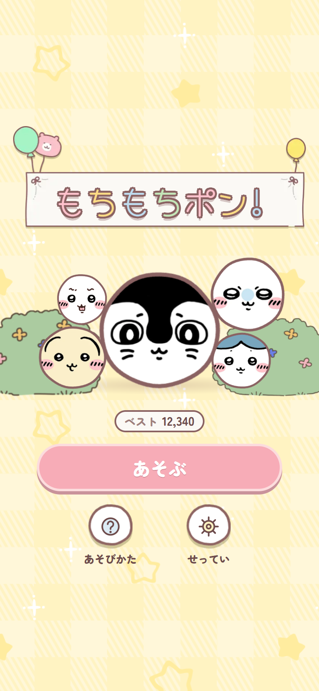
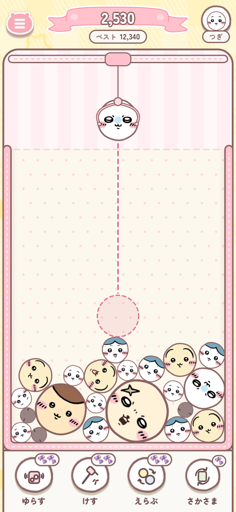
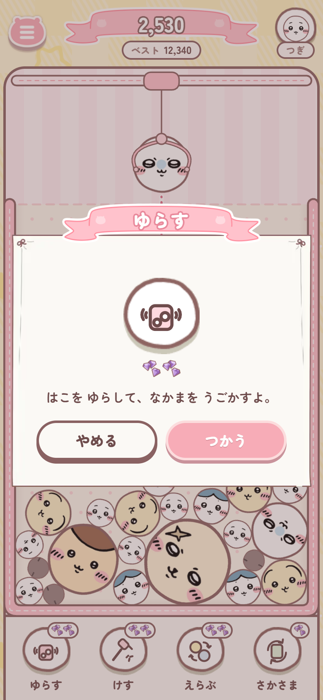
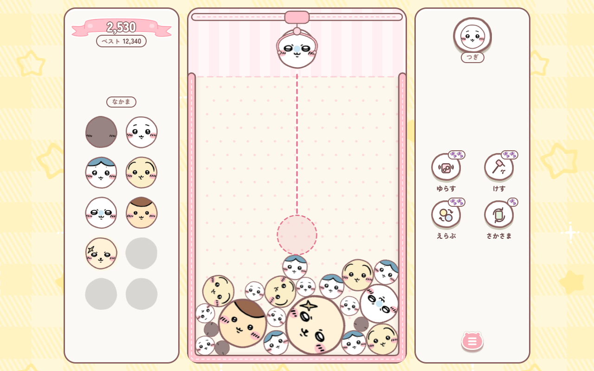

# もちもちポン!

A cosy drop-and-merge puzzle game for the browser, starring hand-drawn Chiikawa friends.

Drop friends into the box. When two of the same friend touch, they squish together into a bigger
friend. Keep merging to reach the biggest one, and don't let the pile stay above the line!

<p align="center">
  
  
  
</p>

<p align="center">
  
</p>

## How to play

- **Aim** by dragging (or moving the mouse), and **let go** (or click) to drop the friend in the claw.
- **Two of the same friend** that touch merge into the next, bigger friend, and score points.
- **Two of the biggest friends** pop and vanish, making lots of room.
- **The dashed line** is the limit: if a friend stays above it for 2 seconds, the game is over.
- The bubble in the top corner shows the next friend. Tap it to see every friend you've found.

## Abilities

Merging friends charges four special moves. Tap one to see what it does before using it.

| | Ability | What it does |
| --- | --- | --- |
| ゆらす | Shake | Rattles the box to loosen a stuck pile |
| けす | Remove | Takes out one friend of your choice |
| えらぶ | Pick | Choose which friend the claw drops next |
| さかさま | Flip | Turns the whole box upside down |

## Features

- Made for phones, and also plays well on fold phones, tablets and PC.
- Friends react with a shocked face when something lands on them.
- Your game is saved automatically, so you can close the page and continue later.
- Background music and sound effects, all made in code.
- Plays offline once it has been opened.
- Japanese-only interface.

## Run it yourself

Requires [Node.js](https://nodejs.org) 20.19 or newer.

```bash
npm install
npm run dev
```

Then open http://localhost:5173. `npm run build` creates a static site in `dist/` that you can
upload to any web host, and `npm test` runs the game's tests.

To change the friends, replace the drawings in `art-templates/` and run
`art-templates/export-balls.ps1` to copy them into the game (see the
[drawing templates](art-templates/README.md)). Gameplay settings such as scoring and ability
charges are in [src/config/game.ts](src/config/game.ts).

## Credits

A fan-made game. Chiikawa and its characters belong to their creators. Fonts: Zen Maru Gothic and
Hachi Maru Pop (Google Fonts).
